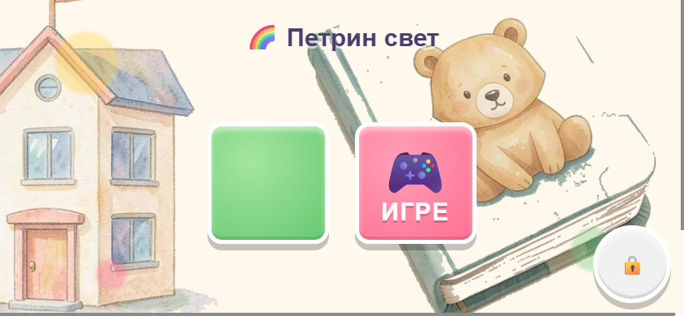

# 🌟 Petrin svet

  

  <strong>A little world for meaningful screen time.</strong> 
  Play · Discover · Create · Learn

  <a href="https://radmanmilos.github.io/Games-for-kids/"><strong>Open Petrin svet ↗</strong></a>
  &nbsp;·&nbsp;
  <a href="game/docs/OFFLINE_INSTALL.md">Offline guide for parents</a>
  &nbsp;·&nbsp;
  <a href="CONTRIBUTING.md">For contributors</a>

  

  
  
  
  

> **If a child is spending time in Petrin svet, that time should be well spent.**

Petrin svet (Петрин свет) is an offline-first collection of playful learning, creative activities and gentle adventures for young children. It is being built with a simple ambition: to make screen time feel worthwhile to a child and easier for a parent to trust.

---

## Why this project exists

Petrin svet began as a personal project for my daughter. The ambition is to make something that can be useful to other families too: not another noisy feed, not a collection of disconnected game templates, and not an app designed to keep a child tapping for as long as possible.

It should feel like one small, welcoming world. A child can follow curiosity, try something, make a picture, listen to a sound, solve a simple challenge or explore a playful environment. The experience should be understandable, forgiving and rewarding without turning learning into homework.

The quality bar is not simply “does the game run?” It is whether the activity makes sense to a young child, whether the interaction feels good, whether the visual world feels cared for, and whether the parent can understand what the app does.

## A note for parents

### What children can do

The current app contains **25 child-facing activity pages**, grouped into learning, creativity and games. Some activities are designed for the youngest children; others are more involved and may suit an older preschooler better. The catalogue is not a formal age rating, so parents should choose activities with their own child in mind.

### What the app deliberately does not contain

- No advertising, tracking, analytics or in-app purchases.
- No accounts, social feeds, chat or public profiles.
- No child progress uploaded to a cloud service.
- No external runtime scripts or online game assets.
- No unnecessary requests for camera, microphone, location or contacts.
- No coins, leaderboards, streak pressure or monetized reward loops.

The runtime safety/privacy audit found only local-origin app requests for its manifests and offline operation. A small amount of progress and preference data is stored locally on the device; it is not sent to a project server.

### Language and interaction

- Child-facing text is in Serbian Cyrillic; speech is in Serbian.
- Basic navigation is designed to be visual and simple, without requiring a child to read a manual.
- Touch targets and interactions are designed for small hands and tablet use.
- Mistakes should be safe: activities favour guidance and another try over punishment or failure.
- Sound and animation support the activity; they should not overwhelm it.

### Offline use

The app can be prepared for offline use from its parent area. Once the offline copy has finished caching, the games and their local assets can be used without an internet connection. An internet connection is needed for the initial visit/offline preparation and for checking and downloading updates.

There is no ZIP download. Offline delivery is handled by the app's service worker.

### The parent area

The parent area provides practical controls and information, including connection state, app version, offline-copy readiness, a local activity summary, offline preparation, update checks and a way to clear locally stored progress.

A simple multiplication question stands between the child-facing hub and these controls. It is only a **toddler speed bump**, not secure authentication or a security boundary. It should never be treated as a way to protect sensitive information.

For step-by-step instructions, see **[Offline use — a guide for parents](game/docs/OFFLINE_INSTALL.md)**.

### A responsible note

Petrin svet is an independent personal project, not a formally certified educational, medical or child-safety product. Automated checks and privacy-conscious design are important, but they do not replace a parent's judgement, device-level supervision or real-world playtesting with children.

---

## What is inside today

The authoritative live catalogue is **[game/data/app-registry.js](game/data/app-registry.js)**. The list below reflects the registered activities at the time of this README update.

### Learning and early skills

- **Учионица** — early learning activities such as the Serbian alphabet, numbers, shapes, colours, time and seasons.
- **Бројање** and **Животиње** — number recognition, counting and animal vocabulary.
- **Памтилица** and **Слагалице** — memory, observation and picture puzzles.
- **Више или мање** and **Разврставање** — comparison and sorting.
- **Слова и звуци** — letters and their sounds.
- **Редослед**, **Ритам**, **Простор** and **Путања** — sequencing, listening, spatial understanding and simple paths.
- **Писање**, **Клавир** and **Облици** — tracing, musical exploration and shape recognition.

### Creativity

- **Бојење** — colour and create at the child's own pace.

### Games and exploration

- **Слагалица бомбона** — a playful matching game.
- **Мала истраживачица** — a gentle exploration adventure.
- **Возила**, **Океан**, **Дино** and **Свемир** — themed worlds to explore.
- **Мала тркачица 3Д** and **Брзи мачак** — action and movement-based play.
- **Мачја шума** — a quiet collecting and decorating experience.

The catalogue will evolve, but adding more games is not the goal by itself. Existing activities should become clearer, more useful, more accessible and more delightful before the project grows just for the sake of a larger number.

---

## The principles behind the experience

1. **Learning through play, never homework.** Activities should invite curiosity and practice rather than test or pressure a child.
2. **Forgiving by design.** No lives, punishment, leaderboard or failure loop. A child should be able to try again and keep exploring.
3. **Child-sized independence.** Clear visual navigation, large touch targets and immediate feedback make the experience easier to understand.
4. **A calm sensory world.** Warmth, colour, sound and motion are used with restraint. Avoid flashing, unnecessary urgency and overwhelming effects.
5. **One coherent world, not one repeated template.** Navigation, feedback and visual language should feel related, while every activity keeps its own character.
6. **Respect for the family's device and attention.** Local assets, offline operation and no engagement tricks are part of the product, not optional extras.
7. **Care over quantity.** New ideas must have a clear purpose and fit the experience.

---

## How the app works

Petrin svet is deliberately simple at runtime:

- **Static web app:** HTML, CSS and JavaScript, with no application build/bundling step.
- **Local assets:** illustrations, fonts, sounds and other runtime files are shipped with the app.
- **Service worker:** prepares and serves the offline copy, and supports update checks.
- **Local progress:** small app-owned records stay in browser storage on the device.
- **One page registry:** game/data/app-registry.js is the source of truth for public activity pages, routes and their test associations.
- **Shared systems:** navigation, audio, speech, touch input, feedback, motion, viewport handling and artwork helpers are reused where appropriate.

### How publishing works

- **game/** is the single source of truth and contains everything required to run the application.
- **docs/** is a generated mirror of **game/**; it is not edited by hand.
- GitHub Pages is published by the **GitHub Actions workflow**, which uploads the committed docs/ mirror only after the configured CI gates have not failed.
- Development resources and test tools are not runtime dependencies.

This separation keeps the deployed app small and self-contained while allowing the project to maintain its reviews, assets, documentation and tests outside the runtime folder.

## Quality, testing and what remains human

The repository has automated checks for syntax, page and route metadata, offline inventories, game-specific interactions, runtime errors, offline end-to-end behaviour and serious/critical accessibility findings. The CI workflow runs the fast gate on pushes and pull requests, selects relevant smoke tests for changed code, and runs release QA when the smoke layer is active. A broader Chromium/WebKit viewport matrix is available for scheduled and manual runs.

These checks are useful evidence, not a claim that every child experience is perfect. Automated accessibility scans do not replace keyboard, touch, zoom and screen-reader review. Screenshot measurements do not replace looking at the screens. Most importantly, a successful smoke test is not a substitute for observing a real child using the activity.

The current audit records **0 short-landscape FAIL findings**, alongside visual WARN items that still need human adjudication. Some manual accessibility, device and game-by-game playtesting also remains. The live record is in **[project/STATUS.md](project/STATUS.md)**.

---

## Explore the project

| If you want to understand… | Start here |
| --- | --- |
| The live app | [Petrin svet](https://radmanmilos.github.io/Games-for-kids/) |
| Offline setup and updates for parents | [game/docs/OFFLINE_INSTALL.md](game/docs/OFFLINE_INSTALL.md) |
| Current verified state and remaining work | [project/STATUS.md](project/STATUS.md) |
| The full list of pages and routes | [game/data/app-registry.js](game/data/app-registry.js) |
| Product decisions that should not be casually changed | [project/DECISIONS.md](project/DECISIONS.md) |
| Rules for AI coding agents | [AGENTS.md](AGENTS.md) |
| Development setup, checks and CI | [CONTRIBUTING.md](CONTRIBUTING.md) |
| Task process and definition of done | [project/PROCESS.md](project/PROCESS.md) |
| Game-specific behaviour notes | [project/games/](project/games/) |
| Visual review screenshots | [resources/General_reviews/Screenshot_Review/TABLE_OF_CONTENT.md](resources/General_reviews/Screenshot_Review/TABLE_OF_CONTENT.md) |
| Test tools and harnesses | [tools/README.md](tools/README.md) |
| Design, learning and technical references | [project/reference/](project/reference/) |

## Repository map

| Folder | Purpose |
| --- | --- |
| **game/** | Complete, deployable application — the runtime source of truth |
| **docs/** | Generated copy of game/, used as the GitHub Pages deployment artifact |
| **resources/** | Development resources: visual reviews, screenshots, references, prototypes and asset work |
| **tools/** | Development, validation, screenshot and test tooling |
| **project/** | Current status, tasks, decisions, lessons, game notes and reference documentation |
| **archive/** | Historical tasks, plans and reviews |

## Run it locally

Serve the **game/** folder over HTTP using VS Code Live Server or another local static web server. Do not open index.html directly with file://: browser security rules prevent some application features, including service-worker behaviour, from working correctly.

The app itself does not need a package installation or compilation step. Development and validation tools use Node.js; see [CONTRIBUTING.md](CONTRIBUTING.md) for the supported workflow and checks.

---

**Petrin svet is a work in progress.** The ambition is steady: build a thoughtful, beautiful and dependable little world in which a child's time is respected — and a parent can see why.
